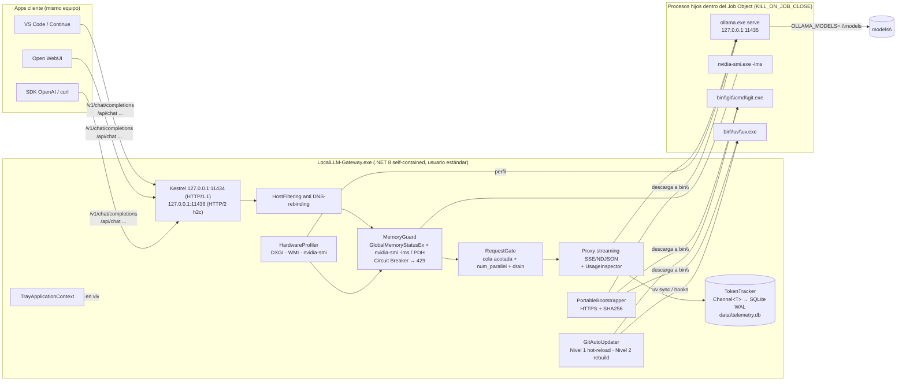

# LLM-Portable

**LocalLLM Portable**: un LLM local para Windows que funciona **sin privilegios de administrador y sin instalación**. Se basa en [Ollama](https://ollama.com) y [uv](https://github.com/astral-sh/uv), y se distribuye como un `.zip` que se descomprime en cualquier carpeta del usuario: Escritorio, Documentos, `%LocalAppData%` o un USB.

- No escribe en `C:\Program Files`, `HKLM` ni `C:\Windows`, y no toca el `PATH` del sistema.
- Todas las rutas son relativas a `AppContext.BaseDirectory`.
- El servidor solo escucha en `127.0.0.1`, así que no salta el Firewall ni pide UAC.

---

## 1. Diagrama de arquitectura Zero-Admin



```text
 Usuario estándar (sin UAC)
 ┌────────────────────────────────────────────────────────────────────────────┐
 │ Apps ──HTTP──► 127.0.0.1:11434  LocalLLM-Gateway.exe                       │
 │                  │ HostFilter → MemoryGuard(429) → RequestGate → Proxy     │
 │                  │                                    │          │         │
 │                  │                       TokenTracker ◄┘          ▼         │
 │                  │                       (SQLite WAL)    127.0.0.1:11435   │
 │                  │                                       ollama.exe serve  │
 │                  └─ Job Object: ollama · nvidia-smi · git · uv · dotnet    │
 │  .\bin  .\models  .\env  .\repo  .\data   ← todo relativo a la carpeta     │
 └────────────────────────────────────────────────────────────────────────────┘
```

**Por qué hay dos puertos:** el Gateway ocupa `11434`, el puerto estándar de Ollama, para que cualquier cliente funcione sin cambiar su configuración. `ollama.exe` corre detrás, en `127.0.0.1:11435`, y no se expone.

---

## 2. Árbol de archivos

### Paquete distribuido (`LocalLLM-Portable-<ver>-win-x64.zip`)

```text
LocalLLM-Portable\
├── Iniciar-LocalLLM.bat        # Lanzador: quita la marca de la web la primera vez e inicia el .exe
├── LocalLLM-Gateway.exe        # Orquestador .NET 8 self-contained, un solo archivo, con icono en la bandeja
├── profiles.json               # Perfiles por defecto (repo\profiles.json tiene prioridad)
├── bin\
│   ├── uv\                     # uv.exe / uvx.exe (se descargan si faltan)
│   ├── ollama\                 # ollama.exe + lib\ (CUDA/ROCm/CPU), del ZIP oficial
│   ├── git\                    # MinGit (solo si no hay git en el PATH del usuario)
│   ├── python\                 # Python gestionado por uv (UV_PYTHON_INSTALL_DIR)
│   └── dotnet\                 # SDK .NET portable, solo para la auto-recompilación (Nivel 2)
├── models\                     # OLLAMA_MODELS
├── env\.venv\                  # Entorno Python aislado (UV_PROJECT_ENVIRONMENT)
├── repo\                       # Clon Git de este repositorio (código + profiles.json)
└── data\
    ├── telemetry.db            # SQLite WAL
    ├── hardware.json           # Huella del hardware + perfil elegido
    ├── admin-token.txt         # Token para POST /v1/system/git-sync
    ├── logs\                   # gateway-*.log, ollama.log, build-*.log
    ├── cache\                  # descargas, uv, HF_HOME, nuget
    ├── tmp\                    # OLLAMA_TMPDIR / TEMP de los procesos hijos
    └── build\                  # compilaciones del Nivel 2 + backup del .exe
```

### Repositorio

```text
LLM-Portable\
├── src\LocalLLM.Gateway\
│   ├── LocalLLM.Gateway.csproj
│   ├── app.manifest              # requestedExecutionLevel = asInvoker (nunca pide UAC)
│   ├── Program.cs                # Entrada: tray | --apply-update | --profile
│   ├── AppServices.cs            # Composición y ciclo de vida (arranque, hot-reload, auto-update)
│   ├── PortablePaths.cs          # Rutas relativas + logger a archivo
│   ├── GatewayConfig.cs          # Modelo de profiles.json
│   ├── NativeMethods.cs          # GlobalMemoryStatusEx, Job Objects, ProcessRunner, entorno portable
│   ├── PortableBootstrapper.cs   # Descarga y extracción de uv/ollama/MinGit/SDK con verificación SHA256/512
│   ├── HardwareProfiler.cs       # DXGI + WMI + nvidia-smi + matriz de decisión + cálculo de encaje
│   ├── MemoryGuard.cs            # Monitor de RAM/VRAM + Circuit Breaker 429
│   ├── TokenTracker.cs           # SQLite WAL + UsageInspector (SSE/NDJSON)
│   ├── OllamaProcessHost.cs      # ollama.exe supervisado + /api/pull con progreso
│   ├── GitAutoUpdater.cs         # Sync Git, Nivel 1/2, UpdateApplier (File.Replace + rollback)
│   ├── InferenceGateway.cs       # Kestrel + RequestGate + proxy + endpoints de sistema
│   └── TrayApplicationContext.cs # Icono en la bandeja, "Iniciar con Windows"
├── python\                       # Proyecto uv (hooks de post-sync)
├── profiles.json                 # Configuración remota
├── Iniciar-LocalLLM.bat
└── build_portable_zip.ps1
```

---

## 3. Uso

1. Descomprime el `.zip` en una carpeta tuya, por ejemplo `%LocalAppData%\LocalLLM-Portable`, el Escritorio o un USB.
2. Ejecuta `Iniciar-LocalLLM.bat`.
3. Aparece un icono **AI** en la bandeja del sistema:
   - gris: iniciando;
   - ámbar: descargando herramientas o modelo, con su %;
   - verde: listo;
   - rojo: Memory Guard activo o error.
4. Configura tu cliente con `http://127.0.0.1:11434/v1` (OpenAI) o `http://127.0.0.1:11434` (Ollama). La API key puede ser cualquier valor.

```bash
curl http://127.0.0.1:11434/v1/chat/completions -H "Content-Type: application/json" -H "X-Client-App: mi-script" -d '{"messages":[{"role":"user","content":"Hola"}],"stream":true}'
```

Si omites `"model"`, el Gateway usa el modelo del perfil activo.

### Endpoints

| Método | Ruta | Descripción |
|---|---|---|
| POST | `/v1/chat/completions`, `/v1/completions`, `/v1/embeddings` | OpenAI, con telemetría |
| POST | `/api/chat`, `/api/generate`, `/api/embed` | Ollama nativa, con telemetría |
| * | `/api/*`, `/v1/models`, … | Se pasan tal cual a Ollama |
| GET | `/v1/metrics?since=2026-11-01&recent=50` | Tokens, TTFT y tok/s por app, modelo y endpoint, más estado en vivo |
| GET | `/v1/hardware-profile` | Hardware detectado, perfil resuelto y decisiones tomadas |
| POST | `/v1/system/git-sync` | Sincroniza ya. Requiere la cabecera `X-LocalLLM-Admin: <data\admin-token.txt>` |
| GET | `/healthz` | Estado, PID y modelo |

Para que tus consumos aparezcan separados en `/v1/metrics`, identifica tu aplicación con la cabecera **`X-Client-App`**. Si no la envías, se usa `User-Agent`.

---

## 4. Compilar y empaquetar

Necesitas un SDK .NET 8. Si no tienes permisos de Admin, puedes instalarlo de forma portable:

```powershell
iwr https://dot.net/v1/dotnet-install.ps1 -OutFile dotnet-install.ps1
.\dotnet-install.ps1 -Channel 8.0 -InstallDir .\.dotnet -NoPath
.\build_portable_zip.ps1 -Dotnet .\.dotnet\dotnet.exe              # zip ligero (descarga herramientas al primer uso)
.\build_portable_zip.ps1 -Dotnet .\.dotnet\dotnet.exe -IncludeTools # zip "offline" con uv + ollama + MinGit
```

El resultado queda en `dist\LocalLLM-Portable-<ver>-win-x64.zip`, junto con su `.sha256`.

Desde macOS o Linux (CI) también puedes compilar con `dotnet build src/LocalLLM.Gateway -p:EnableWindowsTargeting=true`. Ejecutarlo, en cambio, requiere Windows.

---

## 5. Decisiones de diseño y matices

- **Matriz de hardware y cálculo de encaje.** Cada perfil declara el tamaño de los pesos y el KV cache por cada 1k tokens. El perfilador estima `pesos + KV(num_ctx × num_parallel) + margen` contra un presupuesto: VRAM menos `vramReserveMb` menos `minFreeVramMb`.
  - Si el modelo no cabe, baja primero `num_parallel`, luego `num_ctx`, y después prueba los modelos de `fallbacks`.
  - Ejemplo: con 24 GB se elige `qwen3:30b-a3b`. Es un MoE con un KV pequeño, así que entra con 16k × 4 slots. `qwen2.5-coder:32b` con 16k × 4 necesitaría unos 28 GB.
- **Portabilidad por USB.** El hardware se perfila **en cada arranque** y se compara con la huella guardada en `data\hardware.json`. Si mueves la carpeta de un equipo con RTX a uno solo con CPU, se elige otro modelo, se descarga si falta y se ajustan hilos y contexto automáticamente.
- **Parámetros de Ollama.** `num_thread`, `num_gpu` y `num_ctx` son opciones **por petición**, no variables de entorno. El Gateway las inyecta en `/api/*` si el cliente no las envía. Para `/v1/*` se usa `OLLAMA_CONTEXT_LENGTH`. `OLLAMA_KV_CACHE_TYPE=q8_0` solo tiene efecto con `OLLAMA_FLASH_ATTENTION=1`.
- **Tokens exactos en streaming OpenAI.** El Gateway inyecta `stream_options.include_usage=true`, así que el último chunk SSE trae `usage` (es el comportamiento estándar de OpenAI). Puedes desactivarlo con `gateway.injectStreamUsage=false`.
- **HTTP/2.** Sin TLS, Kestrel no puede negociar HTTP/2 por ALPN, de modo que `:11434` sirve HTTP/1.1, que es lo que usan todos los clientes de OpenAI y Ollama. Para HTTP/2 real hay un endpoint h2c ("prior knowledge") en `:11436`. Poner TLS en loopback exigiría instalar un certificado de confianza, y eso choca con Zero-Admin.
- **Memory Guard.** El circuito se abre si la VRAM libre baja de 800 MB o la RAM libre de 2 GB, y se cierra con histéresis (×1.25).
  - VRAM: en NVIDIA se lee con un único `nvidia-smi -lms` en bucle; en AMD, con el contador PDH `GPU Adapter Memory`. Ambos son legibles por un usuario estándar.
  - Además, `OLLAMA_MAX_LOADED_MODELS=1` evita que dos modelos compitan por la VRAM.
- **Seguridad en localhost.**
  - `HostFiltering` (solo `127.0.0.1` y `localhost`) bloquea ataques de DNS rebinding.
  - `git-sync` exige un token en una cabecera personalizada. Eso fuerza un preflight CORS que nunca se responde, lo que impide CSRF desde el navegador.
  - Las descargas solo se aceptan por HTTPS y con hash verificado, en este orden de preferencia: el fijado en `profiles.json`, el `digest` de GitHub, el `.sha256` o `sha256sum.txt` del release, o la tabla de las notas del release. El SDK .NET se verifica con SHA512 usando `releases.json` de Microsoft.
- **Actualización Nivel 2.**
  1. Compila en `data\build\out-<sha>`.
  2. Drena las peticiones activas (las que están en curso terminan; las nuevas esperan en cola).
  3. Lanza el `.exe` nuevo con `--apply-update`. Ese proceso espera a que termine el anterior, ejecuta `File.Replace` con backup, arranca la nueva versión y comprueba que `/healthz` responda con su PID en 10 s.
  4. Si falla, restaura el `.exe` anterior y hace `git reset --hard <commit anterior>`. Se guarda el commit exacto porque `ORIG_HEAD` puede moverse.

  Hay un corte de 1–3 s en el puerto durante el cambio de proceso. Los clientes con reintento no lo notan.
- **Ollama y `%USERPROFILE%\.ollama`.** `ollama.exe` guarda allí su clave `id_ed25519`. Es espacio del usuario, así que no requiere Admin, pero queda fuera de la carpeta portable.
- **SmartScreen.** Un `.exe` sin firmar descargado de Internet puede mostrar "Más información → Ejecutar de todas formas" la primera vez. El `.bat` quita la marca de la web a los archivos de la carpeta. Para distribuirlo en una organización, conviene firmarlo con Authenticode.
- **Intel Arc / iGPU.** Ollama no las acelera oficialmente en Windows, así que esos equipos usan el perfil de CPU.

---

## 6. Licencia

Uso interno. Ollama, uv y Git for Windows se descargan desde sus releases oficiales, bajo sus propias licencias (MIT, MIT/Apache-2.0 y GPLv2).
